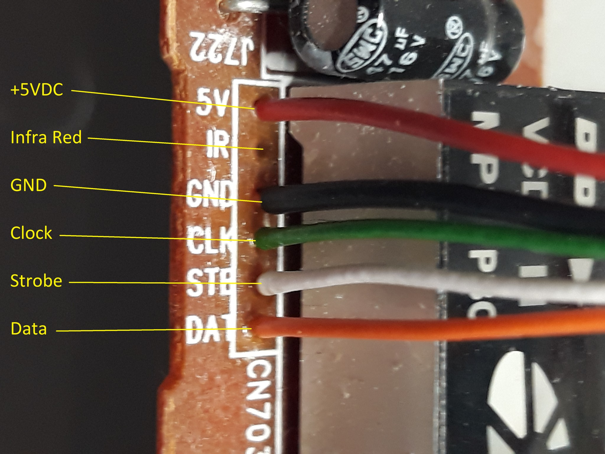

# SM1628 / SM1628B with Arduino Uno

Learn to identify a salvaged display panel's connections, map its LEDs, display
numbers and build a seven-segment Snake game. Start with the display; the game
and demonstration effects are optional projects on top of it.

The examples are based on **José Luis Monteiro's working SM1628B DVD-panel code**.
They target an **Arduino Uno / ATmega328P at 16 MHz**. No external Arduino library
is required. Node.js is only for the automated tests, not for using the sketches.

## Follow the tutorial

| Step | What you will do | Expected result |
|---|---|---|
| [1. Identify and connect the panel](docs/01-connect.md) | Match labels, supply, ground and three control signals | Wiring checked before upload |
| [2. Run the first display test](docs/02-first-display.md) | Upload PanelDemo for this panel, or ManualMap for an unknown map | Numbers or one selected position light |
| [3. Map your own panel](docs/manual-mapping.md) | Select columns and individual bits, then record physical positions | Your own digit/segment map |
| [4. Understand the display memory](docs/04-memory.md) | Build a 14-byte frame without disturbing other groups | An explanation of why the map matters |
| [5. Play Snake](docs/snake-test.md) | Check bars and joystick, start a round and change speed | A playable 49-position game |
| [6. Try display effects](docs/filming-showcase.md) | Sweep, count, carry, blink or run a scripted game | Repeatable visual demonstrations |

**Same driver does not mean same panel.** A panel manufacturer can connect the
display differently, swap the digit/segment roles, reorder digits or allocate
bits to icons. The transport may be reusable while the visible map is different.
Our panel has seven numeric positions and three symbol groups. It is not a
universal wiring profile. See the [reference map](docs/panel-map.md).

This tutorial writes LED display RAM over the three-wire interface; the selected
Uno pins are ordinary GPIO, not a requirement to use hardware-SPI pins. The IC's
key-scan read function and infrared decoding are outside these examples. START
is read directly by the Uno on D4; the panel's IR connection is unused.

## Choose a sketch

| Sketch folder | Purpose | Serial Monitor |
|---|---|---|
| [PanelDemo](firmware/PanelDemo) | Small automatic numeric display example | Not required |
| [ManualMap](firmware/ManualMap) | Hold and inspect individual columns/bits | 9600 baud; Newline or Both |
| [JoystickTest](firmware/JoystickTest) | Read the two analog inputs | 115200 baud |
| [PanelSnake](firmware/PanelSnake) | Joystick-controlled Snake | 115200 baud; pace commands need Enter |
| [PanelShowcase](firmware/PanelShowcase) | Display effects and scripted Snake | 115200 baud; Newline or Both |

Download the repository ZIP and extract it, then open the `.ino` inside the
matching sketch folder. Keep any `.h` files beside that `.ino`. Select **Arduino
Uno** and the correct port, then upload. Uploading another sketch replaces the
previous program on the board. It does not install a second running application.

**Pin ownership:** these sketches preserve the working implementation's
whole-port initialization. Display diagnostics drive D0-D13 as outputs, with
D0 restored as serial input in ManualMap. PanelSnake additionally restores D4
as START input. Read the wiring guide before attaching other peripherals.
This is not drop-in firmware for other Arduino architectures.

[Troubleshooting](docs/troubleshooting.md) · [Circuit parts](docs/circuit-inventory.md)
· [Datasheets](docs/datasheets.md) · [How the code is organized](docs/code-guide.md)
· [Tests](docs/validation.md) · [Credits](CREDITS.md)
