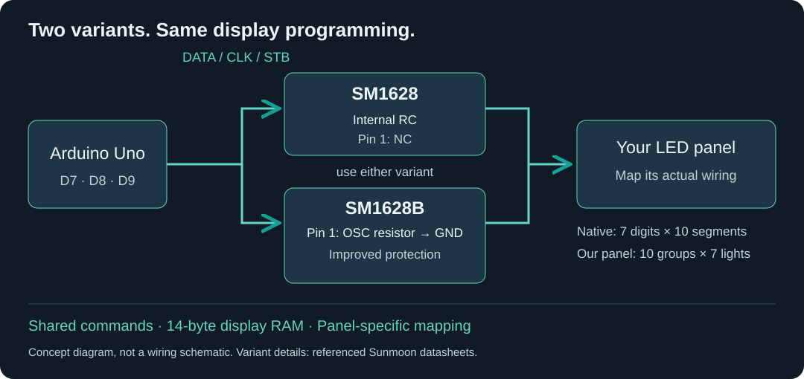

# SM1628 and SM1628B — Arduino driver tutorial

Connect an LED panel to an Arduino Uno, understand the driver's commands and
display memory, find your panel's segment map, and control numbers and symbols.

**Watch the project video:** [Playing Snake on a seven-segment display](https://www.youtube.com/watch?v=3hOSXTLOnHo).
See the salvaged panel in action, from mapping its connections to playing the game.

**SM1628 or SM1628B? Both use the programming approach taught here.** The same
three-wire interface, display commands and 14-byte RAM layout apply to these
examples. There is no separate B-version sketch or variant selector. The main
hardware differences are the oscillator connection and the B variant's improved
protection; see the [short comparison](docs/driver-variants.md).



**Same driver does not mean same panel wiring.** Identify your connector and
map your display before copying the reference panel's lookup table. Changing
the IC suffix alone does not call for a new map; changing the panel can.

## Tutorial contents

| Step | What you will learn | What you will achieve |
|---|---|---|
| [SM1628 and SM1628B](docs/driver-variants.md) | Shared programming and hardware differences | Know what depends on the variant |
| [1. Identify and connect the panel](docs/01-connect.md) | Supply, ground, DATA, CLK and STB | Connect the panel to an Uno |
| [2. Run the first display test](docs/02-first-display.md) | Upload a small example and check the result | Count through numeric positions |
| [3. Map your own panel](docs/manual-mapping.md) | Select columns and individual bits | Record your digit, segment and symbol map |
| [4. Understand memory and commands](docs/04-memory.md) | Native versus swapped wiring, frame construction and transmission | Choose the bytes you send |
| [5. Control numbers and effects](docs/display-effects.md) | Counting, carry, patterns and timing | Try repeatable display demonstrations |

The [reference panel map](docs/panel-map.md) applies these ideas to our assembled
DVD panel: seven numeric digits and three symbol groups. It is one worked
example, not a universal panel configuration.

## 1. Connect the panel

For the reference +5 V panel, connect the following with power disconnected:

| Uno / supply | Panel connection |
|---|---|
| D7 through 1 kΩ | DATA (`DA` or `D`) |
| D8 through 1 kΩ | Clock (`CLK` or `C`) |
| D9 through 1 kΩ | Strobe (`STB` or `S`) |
| GND | Panel GND and supply ground |
| Suitable +5 V panel supply | Panel +5 V input |
| Unconnected | Infrared signal (`IR` or `R`) |


Follow the labels, not connector positions or wire colours. Confirm an unfamiliar
panel's supply requirements first. A separate supply must share ground with the
Uno; do not connect independent +5 V sources together. The signal resistors
are the values used in this build, not a universal level converter.
Our build uses an external +5 V DC supply, with a 470 µF capacitor across its
rails: positive to +5 V and negative to GND. The capacitor is rated 35 V; it
does not set the supply voltage.
See [other photographed connector order and wiring details](docs/01-connect.md).

Start with only the display connected. PanelDemo configures D0–D13 as outputs;
ManualMap restores D0 for serial input. Leave buttons and other peripherals
disconnected from the driven pins during these tests.

## 2. Upload and display numbers

Use an **Arduino Uno / ATmega328P at 16 MHz** and Arduino IDE. No external
Arduino library is required. Download and extract this repository; keep each
sketch's header files alongside its `.ino`.

For the reference panel, open `firmware/PanelDemo/PanelDemo.ino`, select Uno and
the correct port, then upload. Each numeric position counts 0–9, starting at
the left and progressing right. Each numeral lasts about 100 ms. After all
seven positions, the display clears and repeats. Symbol groups stay off.

If your panel has a different map, use the diagnostic below before adapting
the numeric example. Different shapes or positions do not automatically mean
the driver communication has failed. See [first-test results](docs/02-first-display.md).

## 3. Find your panel's map

Upload `firmware/ManualMap/ManualMap.ino`. Open Serial Monitor at **9600 baud**,
with **Newline** or **Both NL & CR** selected. It starts blank.

Send each command separately, followed by Enter:

```text
column 0 7
n
```

**Send `column 0 7` first.** On our panel it lights a 7 on the leftmost numeric
digit. Then `n` advances through raw RAM columns; `p` goes back. Each result
stays lit so you can record it. Reset or `clear` cancels the selection.
Raw column order includes symbols and is not left-to-right digit order.

After selecting a column, `digit 8` lights all seven segment rows for that
column. To check the reference panel in physical order, send `ordered`, then
`n` or `p`. For an unfamiliar panel, first establish your own raw-column map;
`ordered` uses our lookup table.

Our seven numeric positions use columns **`0, 1, 7, 2, 3, 4, 5`**, left to right.
That is the table used by the numeric examples. Individual-bit commands let
you find symbol and segment assignments as well. Follow the
[complete mapping procedure](docs/manual-mapping.md) before copying the map
to a different panel.

## 4. Understand what the driver receives

Both variants use DATA, CLK and STB to receive commands and display bytes.
The examples transmit least significant bit first. The commands used here are:

| Byte | Purpose |
|---|---|
| `0x03` | Select native 7-digit/10-segment mode |
| `0x40` | Select RAM writes with automatic address increment |
| `0xC0` | Start writing at display RAM address `0x00` |
| `0x80` | Turn the display off |
| `0x8F` | Turn the display on at the maximum brightness setting |

These are bytes sent by the sketch, not Serial Monitor commands.

The IC has fourteen display-RAM bytes. Our panel manufacturer swapped the roles
of digit and segment connections, using a common-anode arrangement to obtain
**ten groups of seven lights**. Seven groups are numeric digits; three are
symbols. The driver still uses its native 7×10 mode. Another panel can be
wired differently even when it uses exactly the same IC.

In our transposed map, each segment row occupies a pair of bytes. For example,
to draw a 7 in raw column 0, begin with fourteen zero bytes and set bit 0 in
bytes **0, 2 and 4**: the top, upper-right and lower-right bars. The third
numeric digit is raw column 7, so the same shape uses bit 7 in those bytes.
Preserve the other bits when adding a second digit.

The working sender writes a complete fourteen-byte frame for each update.
This makes the transposed map predictable; it is not a restriction forbidding
the IC's addressed writes. The [memory guide](docs/04-memory.md) includes the
address table, frame-building code and transaction sequence.

## 5. Control numbers and effects

Upload `firmware/PanelShowcase/PanelShowcase.ino`, keeping its headers together.
Open Serial Monitor at **115200 baud**, with **Newline** or **Both** selected.
It starts blank. Send one command per line:

| Command | Expected result on the reference panel |
|---|---|
| `digits` | An 8 sweeps through numeric positions |
| `count` | All numeric positions count 0–9 together |
| `value 9995`, then `carry` | Count upward through the carry into 10000 |
| `bars` | Matching segment rows light across the digits |
| `all` / `blink` | Hold all groups on / flash them |
| `pace 250` | Set effect steps to 250 ms |
| `stop` | Blank the display and cancel the effect |

These examples use our panel map; adapt it after mapping another panel.
No joystick is needed. For the remaining commands and expected behavior,
see [display effects](docs/display-effects.md).

## What you need

An **Arduino Uno / ATmega328P at 16 MHz**, a suitable SM1628 or SM1628B panel,
an appropriate panel supply, and the three 1 kΩ signal resistors used in our
connection example. No external Arduino library is required. Node.js is only
for automated developer tests.

Download the repository ZIP and extract it. Open the `.ino` inside the chosen
sketch folder, keeping its `.h` files alongside it. Select **Arduino Uno** and
the correct port, then upload. A new sketch replaces the previous program.

| Sketch | Purpose | Serial Monitor |
|---|---|---|
| [PanelDemo](firmware/PanelDemo) | Small numeric example; start here for the reference panel | Not required |
| [ManualMap](firmware/ManualMap) | Inspect and map an unfamiliar panel | 9600 baud; Newline or Both |
| [PanelShowcase](firmware/PanelShowcase) | Select numbers, counting, carry and effects | 115200 baud; Newline or Both |

The selected Uno pins are ordinary GPIO: this interface does not require the
hardware-SPI pins. These examples write display RAM; the IC's key-scan read
function and infrared decoding are not covered. The panel's IR pin is unused.

**Pin ownership:** the working sketches retain whole-port initialization.
PanelDemo drives D0–D13 as outputs; ManualMap restores D0 as serial input.
PanelShowcase also restores D4 as an input. Read the connection guide before
attaching other peripherals. Other Arduino architectures need adaptation.

## Optional application: Snake

Once you can control the display, [build the Snake example](docs/snake-test.md)
to combine the driver with a joystick, START button and active buzzer. The
[joystick test](firmware/JoystickTest) and [game sketch](firmware/PanelSnake)
are separate from the display-only learning path. PanelShowcase also includes
a repeatable scripted game demonstration.

The [reference circuit guide](docs/circuit-inventory.md) includes the external
supply, capacitor polarity, joystick track resistors, START network and
transistor-driven active buzzer, with a connection diagram.

## Further help

[Troubleshooting](docs/troubleshooting.md) · [Code guide](docs/code-guide.md)
· [Datasheets](docs/datasheets.md) · [Optional game circuit](docs/circuit-inventory.md)
· [Validation](docs/validation.md) · [Authors and references](CREDITS.md)

## License

This project's code and documentation are available under the [MIT License](LICENSE).
Externally linked datasheets remain the property of their respective rights holders.
