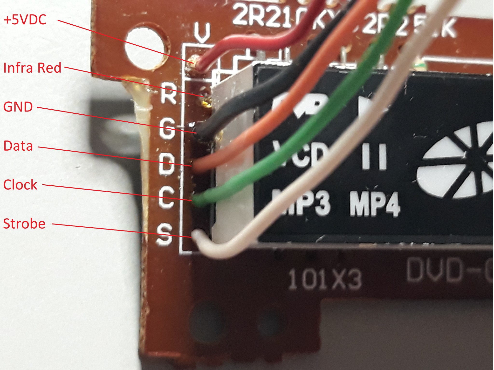

# 1. Identify and connect the panel

Use an Arduino Uno and an assembled SM1628/SM1628B LED panel whose supply and
signal labels you have identified. The photographed reference panel uses +5 V.
Check an unfamiliar panel's actual supply requirements before powering it;
the voltage printed on a capacitor is its rating, not the panel supply voltage.

## Read labels, not connector positions

These two photographed headers place the same functions in different orders.
The photos establish the labelled connection points, not that an unlabelled
panel has the same pinout. IR is unused by these sketches.

| Top to bottom as pictured | Header A | Header B |
|---|---|---|
| 1 | 5 V: +5 V | V: +5 V |
| 2 | IR: infrared signal, unused | R: infrared signal, unused |
| 3 | GND | G: GND |
| 4 | CLK | D: DATA |
| 5 | STB | C: CLK |
| 6 | DA: DATA | S: STB |

## Make the display connections

Disconnect power while wiring. Connect these functions, regardless of their
physical order on your connector:

| Arduino / supply | Connection | Panel label examples |
|---|---|---|
| D7 | Through 1 kΩ resistor to DATA | DA, D, DI/O |
| D8 | Through 1 kΩ resistor to clock | CLK, C |
| D9 | Through 1 kΩ resistor to strobe | STB, S |
| GND | Common ground with the panel supply | GND, G |
| Verified +5 V panel supply | Panel power input | 5 V, V |
| No Arduino connection | Infrared signal | IR, R |

The three 1 kΩ resistors are the values used in this build. They are not a
universal level converter or a substitute for checking supply and logic levels.
This guide does not establish the current demand of an arbitrary panel or
promise that USB/Uno 5 V can power it. If using a separate panel supply, connect
its ground to Uno ground; avoid tying independent +5 V sources together blindly.

## Start with only the display attached

PanelDemo sets all D0-D13 pins as outputs. ManualMap restores D0 to serial RX,
but still drives D1-D13. Leave buttons, buzzers and other devices disconnected
from those pins while using these diagnostics. Disconnecting a button during
this step avoids pressing an input device against a pin configured as an output.

Once wiring is checked, continue to [the first display test](02-first-display.md).
For a different connector, identify its supply/ground and trace DATA/CLK/STB to
the exact IC datasheet; do not guess from wire colours or these photographs.
