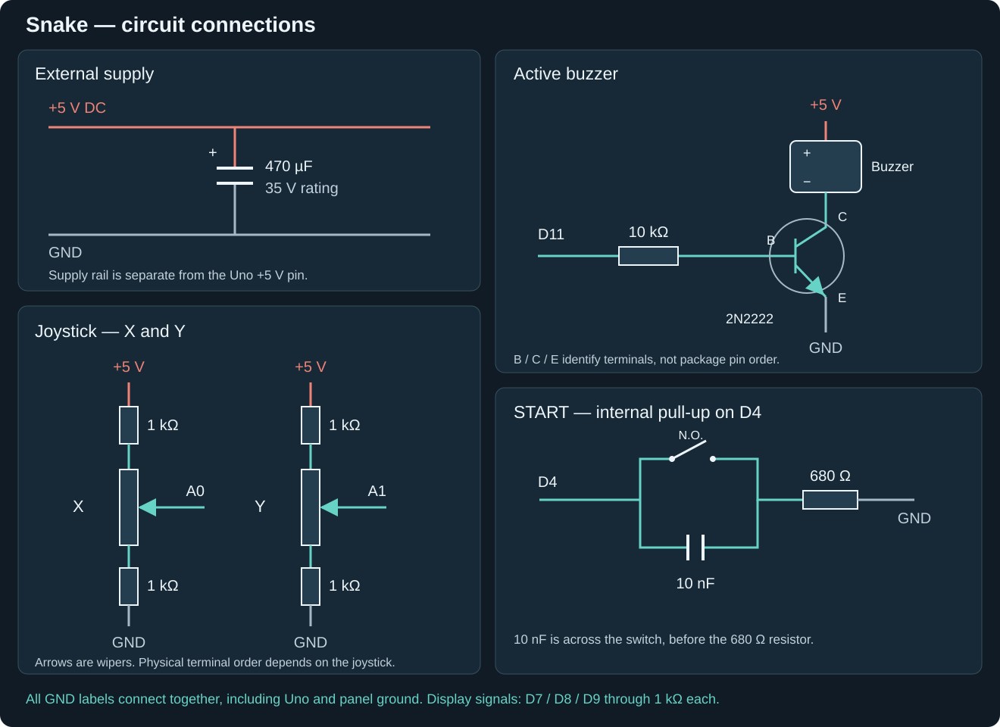

# Optional Snake circuit: parts and wiring

The display-only wiring is complete in [Connect the panel](01-connect.md).
The connections below describe our Uno, joystick, START button and active-buzzer
build. Identify the terminals of your actual components; a transistor's physical
lead order and a joystick connector are not universal.



## Parts

| Part | Quantity | Value / use |
|---|---:|---|
| Uno | 1 | ATmega328P, 16 MHz |
| External supply | 1 | +5 V DC for the panel, joystick and buzzer circuit |
| Assembled SM1628B panel | 1 | Seven digits plus three symbol groups |
| Industrial potentiometer joystick | 1 | X/Y used, rotation/Z unused |
| Resistors | 3 | 1 kΩ in DATA, CLK, STB |
| Resistors | 4 | 1 kΩ at four X/Y track ends |
| Resistor | 1 | 10 kΩ transistor base resistor |
| Resistor | 1 | 680 Ω in START-to-ground path |
| Normally open START button | 1 | D4 input, internal pull-up |
| Capacitor | 1 | 10 nF across START switch |
| Capacitor | 1 | 470 µF, 35 V rating |
| Buzzer driver transistor | 1 | 2N2222-family stage |
| Active buzzer | 1 | DC on/off; D11 controls transistor stage |

Total: nine discrete resistors (seven 1 kΩ, one 10 kΩ, one 680 Ω). Internal joystick
tracks are not additional discrete resistors. The capacitor's 35 V marking is
its rating, not the project's supply voltage.

Fixed potentiometer ends are track ends/outer terminals; the moving contact is
the wiper. Identify the actual joystick terminals. A0=X, A1=Y are firmware
assignments, not a connector pinout. The measured internal resistance excludes the
external 1 kΩ resistors.

The START network is D4 -> normally open switch -> 680 Ω -> GND, with 10 nF
across the switch. The capacitor is not automatically across D4/GND: the resistor
is after the switch. D4 uses INPUT_PULLUP; 680 Ω is not an external pull-down.
Software also requires 30 ms of stable button input.

## External supply and capacitor

We used an external **+5 V DC supply** as a precaution, rather than drawing this
circuit's supply from the Uno's +5 V pin. Connect the external supply ground to
Uno GND and panel GND. The supply must suit the actual panel and connected load.

The **470 µF, 35 V capacitor** provides additional supply filtering. Connect its
**positive terminal to external +5 V** and its **negative terminal to GND**.
It is connected across the supply rails, not in series with the load. The 35 V
marking is a voltage rating; the circuit supply remains +5 V.

Do not join the external +5 V rail to an independently powered Uno +5 V rail.
The common connection required here is GND.

## Joystick potentiometers

For each of the X and Y axes, connect the resistive track between two 1 kΩ
current-limiting resistors:

```text
external +5 V — 1 kΩ — potentiometer track — 1 kΩ — GND
                            |
                          wiper
```

Connect the **X wiper to A0** and the **Y wiper to A1**. There are two external
1 kΩ resistors per axis, four in total. Z/rotation is unused. Use the actual
track-end and wiper terminals, not an assumed connector order. Swapping which
end goes toward +5 V reverses the direction of the voltage change; check the
readings against the game's direction settings.

## Active buzzer and 2N2222

| Connection | Destination |
|---|---|
| Uno D11 | Through 10 kΩ to transistor base (B) |
| Transistor emitter (E) | GND |
| Transistor collector (C) | Active buzzer negative terminal |
| Active buzzer positive terminal | External +5 V |

This is an NPN low-side switch. D11 controls the base stage, not the buzzer's
power directly. The firmware switches D11 HIGH for sound and LOW for silence;
the active buzzer generates its own pitch. Check B/C/E against the datasheet
for your transistor's actual package before wiring it.

## Display connections

Connect the panel to the external +5 V and common GND. D7 goes through 1 kΩ
to DATA, D8 through 1 kΩ to CLK, and D9 through 1 kΩ to STB. Leave IR unused.
Follow [the panel's labelled connector](01-connect.md), not a generic pin order.

Use the START network described above with **PanelSnake**, which configures D4
as an input with pull-up. Disconnect it when running **PanelDemo** or **ManualMap**,
which configure that pin as an output. See [the game guide](snake-test.md) for
uploading, calibration and controls.
