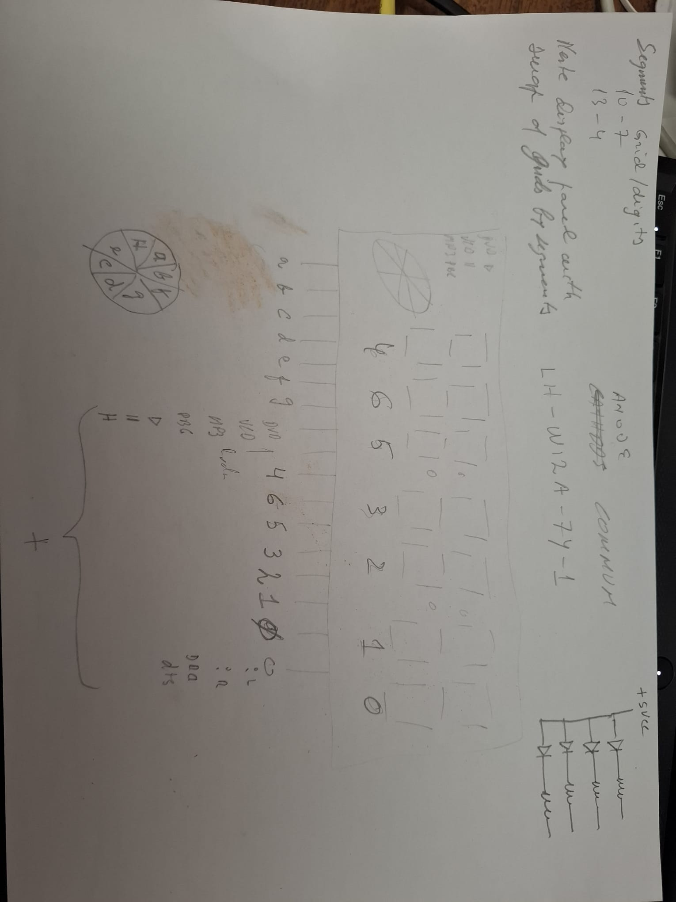

# Panel layout and reverse engineering

## Physical layout — creator clarification, 2026-10-26

The assembled panel has **ten display positions/groups**:
- Seven numeric positions, each a seven-segment digit.
- Three positions containing predefined symbols, including the drawn wheel.

It is not a ten-numeric-digit display. The Snake prototype currently uses the
49 bars of the seven numeric digits; the symbol groups remain separate.
Do not infer seventy identical segments or ten conventional grid outputs.

This is a salvaged, already assembled panel. Its manufacturer chose the
grid/segment routing; the firmware must match those connections.

## Supplied reverse-engineering drawing

Original photograph preserved without rotation, redraw or enhancement.
Supplied filename: WhatsApp Image 2026-10-26 at 6.03.23 PM.jpeg.
SHA-256: CB8280B9A876C037F0C164FC21334F59C15EF14F9ACD77862C4964F3D0EDB789.

The drawing shows the numeral positions, wheel/symbol annotations, a..g
connections and pin-related position labels. It also contains the handwritten
common-anode/grid-segment-swap notes. Preserve it as engineering source material;
do not replace faint handwritten labels with guessed connector or RAM addresses.

The creator clarifies that the numbers beneath the digits represent their
positions **in relation to the pins**. They are not ordinary left-to-right
physical digit indices, and no correspondence to Arduino GPIOs, IC pin numbers
or software shift bits has yet been explicitly supplied.

A provisional visual reading of the seven numeral labels is 4,6,5,3,2,1,0 from
left to right; the first handwritten label remains uncertain. This transcription
has not been accepted as a firmware address table. The creator clarified the
meaning of the numbers but did not explicitly resolve that first glyph.

## Working sketch and observed sequence

The supplied sketch works across all seven visible numeric digits. Earlier
generated examples produced no display output, according to the creator.

Reported visible numeric test order:

    3 -> 1 -> 2 -> 4 -> 5 -> 6 -> 7

Those are physical positions counted from the LEFT, starting at ONE; the report
excludes symbols. They are a different reference system from the drawing's
pin-related labels. Keep both records rather than replacing one with the other.

The working source tests shift slots 0..7. Do not zip that eight-slot list with
the seven numeric positions or guess the remaining output's meaning.

## Next mapping check

Use the drawing to guide an individual-output bench test, and record separately:
physical numeral position, drawing/pin-related label, exact driver RAM byte/bit,
and symbol-group outputs. Only then create or reorder a firmware board map.
PanelDemo's working-reference sequence is unchanged by this documentation update.
